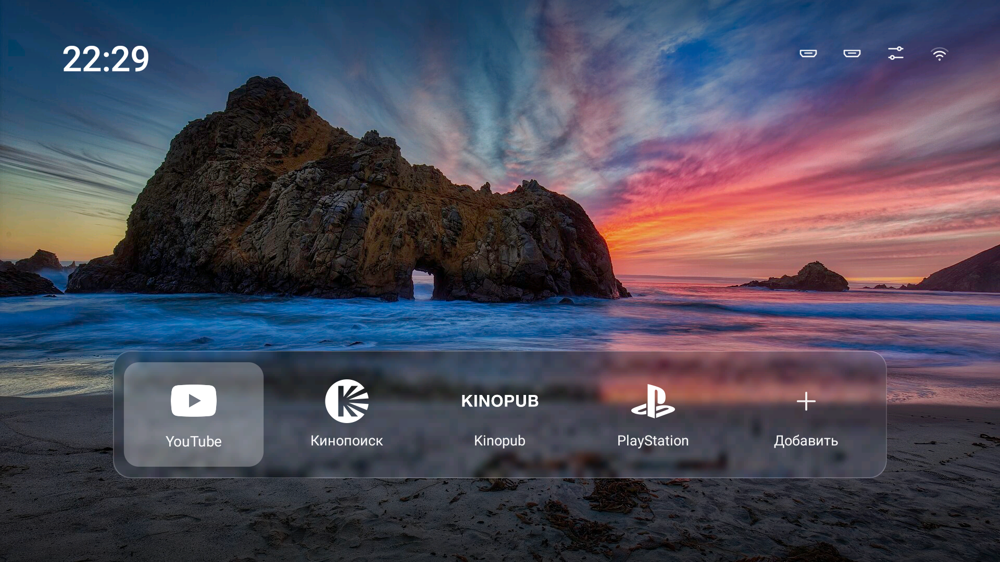

# CleanDroidFrame

A quiet home screen for Android TV: a photo, the time, and a frosted bar with your apps and your game console. Built for the TV remote, light on memory (about 25 MB).



- **Photo wallpaper** with a soft dark edge so the clock and labels stay readable. Plain colour wallpapers are there too (Settings icon, then Wallpaper).
- **A frosted glass bar** as wide as your icons, centred. Two apps make a short bar, six make a wide one, and more wrap onto a second row.
- **White logos** for common apps (YouTube, Netflix, Prime Video, Apple TV, Spotify, Twitch, Plex, VLC, Kinopoisk, Kinopub). Any other app shows its normal icon.
- **A console tile:** HDMI 1 gets its own tile with a PlayStation (or Switch) logo. The other HDMI inputs, Settings and the network icon sit at the top right.
- **One simple screen:** plain Java, no libraries, no Gradle, no animation except a small focus highlight.

It changes nothing else on your TV. It installs one app next to your own home screen and never turns anything off.

> **Tested on one TV only:** a Xiaomi MiTV-MSSP1 (Android TV 9, 2 GB RAM). Other Android TVs and Google TVs may need small fixes. Use it at your own risk. Reports are welcome as issues; include the TV model, Android version and what you saw.

## Get it on your TV

You need a computer on the same Wi-Fi as the TV, with [adb](https://developer.android.com/tools/releases/platform-tools), Java 17 and the Android SDK.

**1. Turn on debugging on the TV.** Settings, Device Preferences, About, press **Build** 7 times. Then in Developer options turn on **USB debugging** (and **Network debugging** if there is one). Note the TV's IP address (Settings, Network).

**2. Build** (macOS shown; on Linux install the same things with your package manager):

```sh
brew install android-platform-tools openjdk@17
brew install --cask android-commandlinetools
sdkmanager "platforms;android-34" "build-tools;34.0.0"
sh build.sh
```

**3. Install:**

```sh
sh install.sh <TV_IP>                                    # apps from apps.txt that are installed
sh install.sh <TV_IP> "com.netflix.ninja,com.spotify.tv.android" playstation
```

The first time, the TV asks "Allow USB debugging?". Tick Always allow and press Allow, then run it again. Press Home on the remote.

**4. Turn debugging off again** when you are done. While it is on, other devices on your network can ask to control the TV. Turn it back on only to change things or to undo.

### Options

| What | How |
| --- | --- |
| Choose the apps | pass package names to `install.sh`, or edit `apps.txt` before `build.sh`. Find names with `adb shell pm list packages -3`. On the TV, hold OK on an app to move or remove it. |
| HDMI 1 tile | third argument: `playstation` (default), `nintendoswitch` or `none` |
| Wallpaper | Settings icon on the TV, then Wallpaper. Or `adb shell am start -n app.cleandroidframe/.MainActivity --es wallpaper Dusk` |
| Your own photo | put a 1920x1080 JPG in `assets/`, add its name to `PHOTOS` and `WALLPAPER_NAMES` (and a colour row to `WALLPAPERS`) in `MainActivity.java`, rebuild |
| More logos | see `assets/icons/CREDITS.md` |

### If Home still opens your TV's own screen

Many TVs keep opening their own home screen when you press Home. Pick CleanDroidFrame in the chooser and choose Always. If that does not stick, the TV's own launcher has to be turned off. That is the risky part: on a few TVs, turning off the wrong system app left the TV stuck on the logo or restarting. Read the notes in [tv-detox](https://github.com/Ansub/tv-detox) first (its README and `docs/debloat.md`), keep a list of what you turn off, and never turn off the TV's setup, settings, input or keyboard apps. On Google TV, leave Google TV's own home screen on.

### Undo

```sh
sh undo.sh <TV_IP>
```

This removes CleanDroidFrame and sets Home back to what it was when you installed. If you turned your TV's own launcher off, turn it back on with `adb shell pm enable <package>`.

## Credits and references

- **[tv-detox](https://github.com/Ansub/tv-detox)** by Ansub Khan (MIT). CleanDroidFrame started from its home screen app and build script, and the install flow follows its approach. tv-detox is also the place to learn how to clean up and speed up an Android TV safely.
- **[CleanFrame](https://github.com/nthnclrk/CleanFrame)** by nthnclrk. The design here (photo, clock, frosted bar, white logos) is inspired by CleanFrame, a home screen for the Samsung The Frame. No CleanFrame code or assets are used. CleanFrame runs on Samsung's Tizen, not Android.
- **[Simple Icons](https://simpleicons.org)** (CC0) for the logos. They are trademarks of their owners.
- **Photo:** "Big Sur, California - Poseidon's Gate" by Janusz Sobolewski, CC BY 2.0, via Wikimedia Commons. See `assets/PHOTO-CREDIT.md`.

## License

MIT, see [LICENSE](LICENSE). It covers the code. The photo and logos keep their own terms, listed above. CleanDroidFrame is an independent project and is not affiliated with any TV maker or streaming service.
